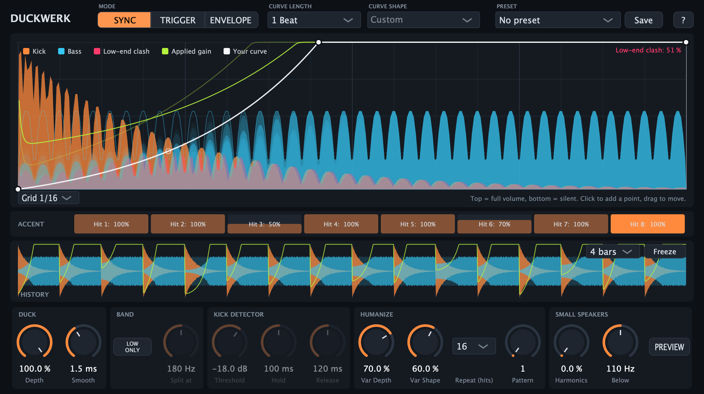

# Duckwerk

Sidechain ducker for kick and bass, built for techno / hard techno / uptempo. VST3, macOS (Apple Silicon + Intel), made with JUCE.



## What it does

- **Three modes** – SYNC (curve follows the song tempo, no routing), TRIGGER (every real kick restarts the curve), ENVELOPE (ducking follows the kick level).
- **Draw your own curve** – click to add points, drag rings to bend, 8 starting shapes, length from 1/4 beat to 8 beats.
- **Low only** – duck just the low end and keep the bass's upper tones.
- **See what happens** – the last 10 cycles of kick and bass are stacked behind the curve; red marks where both still fight for the low end. A scrolling history shows the last bars.
- **Humanize** – per-hit accents plus depth/shape variation that repeats after 4–32 hits, so it grooves instead of sounding random.
- **Small speakers** – generates harmonics from the sub so the bass stays audible on phones and laptops; PREVIEW lets you hear the mix without sub.
- **Presets** – saved to `~/Library/Audio/Presets/Duckwerk`.

Every control has a tooltip, and the `?` button shows a quick start including the sidechain routing in FL Studio.

## Build

Needs Xcode and CMake. JUCE is downloaded automatically.

```bash
cmake -S . -B build -DCMAKE_BUILD_TYPE=Release
cmake --build build --target Duckwerk_VST3 DuckwerkTest -j 10
```

Install:

```bash
cp -R build/Duckwerk_artefacts/Release/VST3/Duckwerk.vst3 ~/Library/Audio/Plug-Ins/VST3/
```

Then run "Find installed plugins" in FL Studio's plugin manager.

## Test

`DuckwerkTest` feeds a synthetic kick and bass through every mode, checks the results and renders the editor to PNG files:

```bash
./build/DuckwerkTest_artefacts/Release/DuckwerkTest "$PWD/screenshots"
```

## Note

JUCE is free for personal use and under its own licence for anything commercial; see https://juce.com/get-juce.
